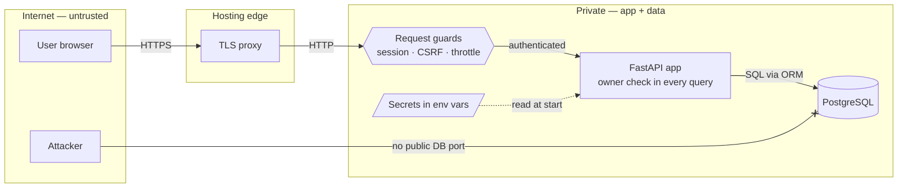
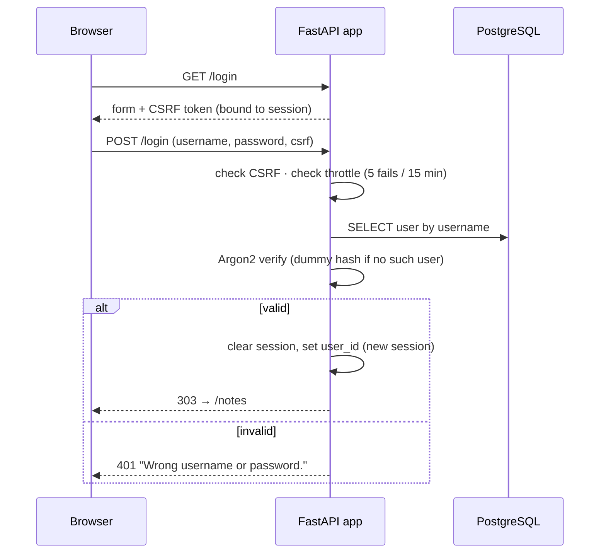

# SecureNotes — Threat Model

| | |
|---|---|
| **Version** | 1.0 — 2026-11-15 |
| **Method** | STRIDE per element, mapped to MITRE ATT&CK (Enterprise) |
| **Scope** | The web app in `app/`, its database and its secrets, as deployed behind a TLS-terminating host |
| **Out of scope** | The hosting provider's own infrastructure, the user's device and browser, DNS |

The polished data-flow diagram is [`threat-model-dfd.html`](threat-model-dfd.html) (open it in a browser).
The Mermaid versions below render directly on GitHub.

---

## 1. What we are protecting

| Asset | Why it matters | Where it lives |
|---|---|---|
| **Note contents** | Private by design; leaking them is the worst outcome | `notes` table |
| **Credentials** | Reused passwords hurt users far beyond this app | `users.password_hash` (Argon2id) |
| **Sessions** | A stolen session is a stolen account | Signed cookie `securenotes_session` |
| **`SECRET_KEY`** | Signs every session; leaking it lets anyone forge one | Environment variable |
| **Database URL** | Contains the database password | Environment variable |
| **Availability** | The app is useless if it is down | Hosting platform |

## 2. Actors

| Actor | Trust | Capability assumed |
|---|---|---|
| Registered user | Trusted for **their own** notes only | Browser, valid session |
| Other registered user | Untrusted towards anyone else's data | Valid session of their own; can craft any request |
| Anonymous internet attacker | Untrusted | Can send any HTTP request, run password lists, host a malicious page |
| Operator (me) | Fully trusted | Deploys code, holds secrets |

## 3. Data flow and trust boundaries

**Trust boundaries**

1. **Internet → hosting edge.** Everything that crosses it is hostile until proven otherwise. TLS starts here.
2. **Hosting edge → app.** Requests arrive authenticated by nothing; the request guards decide.
3. **App → database.** Only the app holds the database credentials; the database has no public port.

### Login, the most attacked flow

---

## 4. Threats (STRIDE)

Status: ✅ mitigated and tested · 🟡 partially mitigated · ❌ open (see §6).

### Spoofing — pretending to be someone else

| ID | Threat | Mitigation | Status |
|---|---|---|---|
| S1 | Password guessing / credential stuffing against `/login` | Per username+IP throttle, 5 failures per 15 min (`test_login_is_throttled_after_five_failures`) | 🟡 throttle is in-memory, per process |
| S2 | Forged session cookie | Cookie signed with `SECRET_KEY` (itsdangerous); app refuses to start in production without a key | ✅ |
| S3 | Session fixation | Session cleared and recreated on login (`test_session_is_renewed_on_login`) | ✅ |
| S4 | Weak passwords make S1 easy | 12–128 characters, must differ from username (`test_weak_password_rejected`) | 🟡 no breached-password check |

### Tampering — changing data you should not

| ID | Threat | Mitigation | Status |
|---|---|---|---|
| T1 | Editing or deleting another user's note by changing the ID (IDOR) | Ownership is part of the SQL `WHERE`; foreign notes return 404 (`test_cannot_edit/delete_someone_elses_note`) | ✅ |
| T2 | Cross-site request forgery from a malicious page | Per-session CSRF token on every form, constant-time compare, `SameSite=Lax` (`test_post_without_csrf_token_is_rejected`) | ✅ |
| T3 | SQL injection | SQLAlchemy ORM with bound parameters; no raw SQL | ✅ |
| T4 | Tampered dependency (supply chain) | Pinned versions in `requirements.txt` | 🟡 no automated vulnerability scan yet — phase 3 |

### Repudiation — denying you did something

| ID | Threat | Mitigation | Status |
|---|---|---|---|
| R1 | No record of logins, failed logins or deletions | — | ❌ no audit log |

### Information disclosure — reading what you should not

| ID | Threat | Mitigation | Status |
|---|---|---|---|
| I1 | Reading another user's notes (IDOR) | Owner check in every query; list page filters by owner (`test_users_only_see_their_own_notes`) | ✅ |
| I2 | Stored XSS stealing data from other pages | Jinja2 autoescape + strict CSP, no inline script (`test_note_content_is_html_escaped`) | ✅ |
| I3 | Username enumeration via login errors or timing | Same message and status for both cases; dummy hash on unknown user (`test_login_error_does_not_reveal_which_part_was_wrong`) | 🟡 sign-up still reveals "username taken" |
| I4 | Database dump exposes passwords | Argon2id hashes (`test_password_is_hashed_with_argon2`) | ✅ |
| I5 | Secrets committed to git | Secrets only from environment; `.env` git-ignored | 🟡 no secret scanner yet — phase 3 |
| I6 | API schema maps the app for attackers | `/docs` and `/openapi.json` disabled in production | ✅ |
| I7 | Pages cached by shared proxies or browsers | `Cache-Control: no-store`, `Referrer-Policy: no-referrer` (`test_security_headers_present`) | ✅ |
| I8 | Traffic sniffed in transit | TLS at the edge, HSTS in production, `Secure` cookie flag | 🟡 depends on the host's TLS setup |

### Denial of service — making it unavailable

| ID | Threat | Mitigation | Status |
|---|---|---|---|
| D1 | Huge inputs exhaust memory or storage | Length limits on every field (`test_overlong_note_rejected`) | ✅ |
| D2 | Request floods / CPU exhaustion via Argon2 | Only failed logins are throttled | ❌ no global rate limit |
| D3 | Unbounded note count per user | — | ❌ no quota |

### Elevation of privilege — gaining powers you should not have

| ID | Threat | Mitigation | Status |
|---|---|---|---|
| E1 | Unauthenticated access to note routes | Every note route depends on `current_user` (`test_notes_require_login`) | ✅ |
| E2 | Clickjacking tricks a logged-in user into actions | `frame-ancestors 'none'`, `X-Frame-Options: DENY` | ✅ |

---

## 5. MITRE ATT&CK mapping

How a real attacker would approach the app, and what stands in the way.

| Tactic | Technique | Against SecureNotes | Defence | STRIDE |
|---|---|---|---|---|
| Reconnaissance | T1595 Active Scanning | Probing routes, `/docs`, headers | API docs off in prod, no version banners | I6 |
| Initial Access | T1190 Exploit Public-Facing Application | IDOR, XSS, SQLi, CSRF | Owner-scoped queries, autoescape + CSP, ORM, CSRF tokens | T1–T3, I1–I2 |
| Credential Access | T1110.001 / .004 Brute Force: Guessing, Credential Stuffing | Password lists against `/login` | Throttle, strong-password rule, Argon2 cost | S1, S4 |
| Initial Access | T1078 Valid Accounts | Logging in with stolen credentials | Throttle limits abuse; **no MFA yet** | S1 |
| Credential Access | T1539 Steal Web Session Cookie | Cookie theft via XSS or sniffing | `HttpOnly`, `Secure`, CSP, TLS | S2, I2, I8 |
| Credential Access | T1552.001 Unsecured Credentials: Credentials in Files | `SECRET_KEY` or DB URL leaked in the repo | Env-only secrets, `.env` ignored; scanner in phase 3 | I5 |
| Collection | T1213 Data from Information Repositories | Bulk-reading other users' notes | Owner check returns 404 for foreign IDs | I1 |
| Impact | T1499 Endpoint Denial of Service | Flooding expensive endpoints | Input limits; **no global rate limit** | D1–D2 |
| Initial Access | T1195.002 Compromise Software Supply Chain | Malicious or vulnerable dependency | Pinned versions; SCA scan in phase 3 | T4 |

---

## 6. Open risks and next steps

| Risk | Plan | Phase |
|---|---|---|
| No dependency or secret scanning (T4, I5) | `pip-audit`, `gitleaks`, Bandit in GitHub Actions; fail the build on high severity | 3 — CI pipeline |
| Throttle resets on restart and is per process (S1) | Move counters to the database or Redis when running more than one instance | later |
| No global rate limit (D2) | Rate limit at the edge or with middleware | later |
| No audit log (R1) | Log sign-in, failed sign-in, note deletion — without note contents | later |
| No MFA (T1078) | TOTP as an optional second factor | later |
| Sign-up reveals taken usernames (I3) | Accept that for a notes app; rate-limit sign-up | later |
